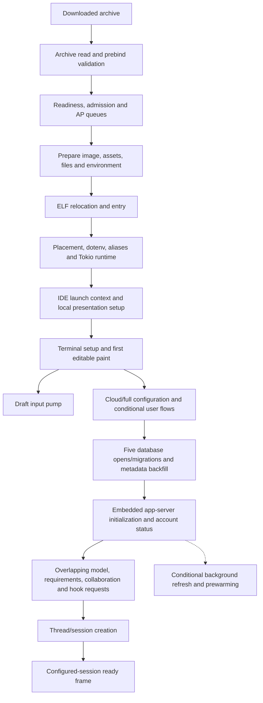

# Codex startup on TRUEOS: execution map and measurements

Source audit: 31 October 2026. Scope begins after archive download, through
loading, first editable paint, session readiness, and first-turn preparation.
Compiler optimization and persisting an executable image are outside this work.
The execution map combines source-established dependencies with separately
identified live observations; source complexity alone does not establish cost.

Current result: the verified `392016b8…` archive completed normal
`cargo bp codex-cli` packaging and publication
([build receipt](startup-build-2026-10-31-skills.json)). Its same-binary skills
control reduced attachment-to-ready from 19,003 ms to 21 ms. With coalescing
enabled, the provisional composer appears around 0.4 s and the configured
session around 8–11 s from application timing origin; host loader timings use
a separate clock. Early draft echo still takes up to 4.1 s, and two-worker
results are inconsistent ([live evidence](startup-skills-2026-10-31-live.json)).
The repeated pre-Tokio outage now has a controlled placement result. Kernel A
stalled in an awaited range read on the fifth clean launch, whose initial VMX
carrier was AP 14. That AP also hosted the permanent Skhynix disk service.
Kernel B changed only the service placement to BSP 0: its fifth launch again
used AP 14, entered Tokio, reached readiness at 9,020 ms, and fully retired.
The native read had no active std thread from which to yield its carrier, so
the AP could not poll the service needed to complete that read. Extra Tokio
workers cannot repair this wait before Tokio exists. See the
[matched live comparison](startup-read-range-placement-2026-10-31-live.json).
The production policy requires BSP 0 for this disk service, retaining other
devices' policies and the executor wait guards. Its normal coupled build,
compatibility checks, source promotion, and tests pass
([production provenance](startup-block-service-2026-10-31-production.json)).
Five clean serial Codex launches reached readiness and fully retired, including
AP 14 on the fifth launch at 8,778 ms. The sixth alias attempt failed fetching
the catalog before Codex started. After proving that pullbot's retirement, a
separate alias retry completed another Codex startup at 9,307 ms. This is six
successful Codex startups, not six consecutive successful alias attempts; the
original six-attempt series retains its failed result. The latest session is
retained with its controlled draft cleared. See the
[production live proof](startup-block-service-2026-10-31-live.json).
The earlier [native-FS proof](startup-native-fs-2026-10-31.json) remains a
historical diagnostic-only result.

## Two readiness points

`editable_composer_visible` follows the provisional composer's first completed
paint. It accepts draft edits while configuration and backend startup continue.
`session_prompt_ready` is a readiness proxy emitted after drawing with a
configured primary session, no pending thread start, and no active modal. Its
two call sites also check different event-queue/protected-request conditions.
It does not prove every submission guard is open, and delayed drawing can delay
the marker. The analyzer calls this `session_ready_frame_ms`. A visible composer
is not proof that SQLite, authentication, models, or thread creation have finished.



The input pump and backend futures generally share one cooperative task through
`StartupDraft::run_until`. Waiting futures yield to input. A long synchronous
`poll` still blocks that task. Spawning extra futures does not isolate that work.

## Existing capture: what is already observable

The already-running host collector contained one legacy startup sequence. It
selected placement mode 1 with a two-carrier background cap (`isolated 2`). Timings
below are application-source timestamps, not packet arrival times:

| Recorded point or interval | Observed wall time |
|---|---:|
| First backend flush | 377 ms from application timing origin |
| Provisional composer painted | 378 ms from application timing origin |
| State DB initialization gate | 5,640 ms |
| Embedded app-server startup | 3,680 ms |
| Account status request | 1,724 ms |
| Thread-start task | 14,114 ms |
| Thread-start completion to ready-frame marker | 40,316 ms |
| Ready-frame marker | 73,585 ms from application timing origin |

These intervals overlap other work and do not partition total startup. The
capture lacks archive identity, request IDs, and poll measurements, so it is a
single legacy observation rather than a controlled comparison. PID transitions
from Hull 1001 to native 1 are consistent with this path, but PID-only records
cannot establish unique launch identity. A completed flush/paint is also not a
measurement of when an SSH client physically presented those pixels.

The late 40.316 s gap does not establish continuous freezing or CPU work.
`thread_start_done` precedes posting its UI event. Attachment, an optional
fallback RPC, tooltip persistence during app construction, event draining,
protected interaction, and drawing can happen afterward. Known onboarding and
initial hook/model-review decisions precede thread spawning and should not be
offered as explanations for this later gap. No unconditional 40 s timer was
found in the inspected fresh attach path.

New probes divide this region using `thread_start_event_received`,
`tui.thread_attach`, `primary_session_attached`,
`tui.startup_backend_fallback`, and `thread_attach_done`/`failed`. The initial
report is saved at `/tmp/trueos-codex-existing-startup-report-20261031.json`;
its capture metadata records bytes read and the SHA-256 of those bytes.
A compact, sanitized observation is retained in
[`startup-baseline-2026-10-31.json`](startup-baseline-2026-10-31.json).

The production-source host experiment also checked measurement interpretation:
a 25 ms pause outside polling produced 25.039 ms wall time and 0.001 ms total
poll time; a 20 ms sleep inside a poll produced 20.069 ms wall time and a
20.057 ms maximum poll. This validates classification, not hardware startup
performance or CPU consumption. Artifacts are under
`/tmp/codex-startup-poll-experiment-20261031.{log,json}`.

## Live repacked-image baseline

The live rig was reached over SSH and launched the independently verified
`2797ba5fdbe601f56b0cca47621863a7e8e2a06d91865b88ce1eba6f11c3c286`
archive. Its new application probes work; host loader/request probes are absent
on this rig, so loader cost and unique Hull/native PID joining remain unmeasured.

The first fresh process painted at 137 ms and finished attachment at 12,111 ms.
The ready frame arrived at 52,237 ms, after a harmless draft-paste experiment.
The database gate was 2,181 ms, embedded server 3,490 ms, thread creation 3,406 ms,
and attachment only 36 ms. Individual DB opens/migrations totalled about 0.7 s;
the metadata consistency gate was just 18 ms. Deferring unused stores is therefore
a smaller candidate than the aggregate DB gate alone suggested.

A second fresh process with an already-running SQLite service attached at
11,004 ms. A controlled five-host-second period after observing attachment
contained no input and no ready frame; the initial paste echo then timed out.
Readiness eventually appeared at 31,349 ms. These observations establish a
post-attachment presentation delay, but do not attribute its whole duration to
one handler or prove a lost wakeup.

The rig reports one visible CPU to ordinary Blueprint applications. Tokio's
default therefore created only one async worker despite the `isolated 2`
placement profile. Scheduler probes show long continuations of that worker
while other work queues; allocator counters also show substantial scan work.
These are elapsed continuations and work counts, not CPU attribution. Once the
first session settled, five SSH draft-paste echo samples ranged from 28.586 to
39.825 ms (median 30.882 ms); no prompts were submitted.

A third control used the same pre-fix archive with `TOKIO_WORKER_THREADS=2`.
Two async-scheduler jobs were observed. Attachment completed at 12,539 ms,
but no ready frame appeared during the five-second no-input window, and the
subsequent draft echo timed out after 15 seconds. Both async workers later
remained inside unchanged guest-enter continuations for tens of seconds while
ABI counters advanced. Increasing the pool alone did not resolve this stall;
the boundary ages measure elapsed continuations, not CPU time. The temporary
dotenv file was removed after the trial.

The current source addresses two concrete dependencies:

- A fresh session performs one foreground handoff paint after draft restoration
  and queued history/protected-request processing. It retains the pending paint
  if rendering is skipped or fails, and emits `startup_handoff_frame_rendered`
  after actual success. It does not require a frame-scheduler timer or new input.
- Tokio keeps one async worker by default. The successfully admitted placement
  snapshot bounds explicit experiments: `single` allows one, while `isolated N`
  and `spread N` allow 1–N, bounded to 1–4, through `TOKIO_WORKER_THREADS`.
  Invalid or excessive values fail before runtime creation. The blocking pool
  remains capped at eight. The numeric
  `runtime_workers_configured` record exposes the selected limits.

The retained live baseline is
[`startup-baseline-2026-10-31-live.json`](startup-baseline-2026-10-31-live.json).
The rebuilt archive
`eacb51c8a6a8e830a0028e65c3200d25030850484b6183d175584012ddf5ff10`
passed its independent container, ELF, workload-source, kernel-hook, and published
copy checks. A fresh one-worker run painted the composer at 399 ms, attached at
13,401 ms, and finally painted the configured session at 51,985 ms. The new
handoff marker followed at 51,986 ms. No ready/handoff frame appeared during the
five-second no-input window, and the first draft echo timed out after 15 seconds.
The handoff path executes, but the 38,584 ms attachment-to-ready gap remains.
This single comparison establishes neither a speedup nor a regression.

The subsequent two-worker attempt reached only `process_main`. It blocked before
placement, dotenv, and runtime initialization; it cannot measure the effect of
two Tokio workers. At stop, the VM reported one pending synchronous filesystem
request and no native jobs. HTTP filesystem access also timed out, then refused
connections, while SSH continued to work. The test process was stopped. The
first trial's temporary dotenv was removed. An approved rig reboot restored
filesystem access; the second temporary dotenv was then matched to the exact
test bytes, removed, and verified absent. The existing `isolated 2` profile was
preserved. A recovered trial uses its default two-worker pool without a new
override file.

That recovered trial confirmed two workers, painted at 384 ms and attached at
9,738 ms. Ready and handoff eventually appeared at 162,669 ms: a 152,931 ms gap.
A completed async continuation reached 126.0 s, and allocation counters reached
3.50 million calls / 3.42 billion candidate visits. Once settled, five draft echo
samples had a median of 29.640 ms and maximum of 30.547 ms, including SSH delivery.
These are elapsed boundaries and work counts. They establish
that a second worker alone did not fix that archive's stall; they do not
attribute CPU cost.
The tested archive selected N workers by default as an initial experiment.
Current source deliberately retains one unless a larger pool is explicitly
requested. The later worker comparison below uses the skills-corrected archive
and must be assessed separately.

Additional source probes now distinguish the initial thread-event drain,
post-attachment AppEvent handlers, handoff guards, and the actual render call.
The later `f9cce017…` archive executed these probes: startup AppEvent sample 3
ran from 9,086 to 28,228 ms, waiting 19,142 ms while spending only 3 ms in four
polls. Initial drain took 9 ms and the handoff paint 5 ms. Full WebSocket
preparation was deferred. Source ordering points to a second forced skills
refresh queued on attachment: plugin mentions, header history, then automatic
`CodexOp(ListSkills)` match the observed other/history/other categories. That
command awaits `skills/list`, whose server path clears plugin/skills caches,
reloads config, resolves plugins, and scans skills. The old numeric categories
cannot prove this event's identity, and pending wall time is not CPU attribution.
The existing background startup refresh already requests the same forced read.
The same run's first draft echo also took 12.387 s after
readiness, motivating a separate bounded post-handoff probe budget.

The sanitized comparison and recovery state are retained in
[`startup-comparison-2026-10-31-live.json`](startup-comparison-2026-10-31-live.json).

The combined `392016b8…` archive subsequently completed packaging and normal
cache-hit publication, with an independent published-copy hash match. On the
same kernel and binary, coalescing enabled attached at 9,395 ms and painted ready
at 9,416 ms: a 21 ms gap. Control `CDX_STARTUP_SKILLS_COALESCE=0` attached at
9,066 ms and painted ready at 28,069 ms: a 19,003 ms gap. Its statically named
`RefreshSessionSkills` handler waited 18,976 ms, with only 2 ms in five polls;
draining took 13 ms and painting 7 ms. Restoring coalescing with full prewarming
enabled produced a 32 ms attachment-to-ready gap. This controlled reversal
identifies the duplicate foreground skills request as the late readiness
dependency in these runs. It does not identify server CPU cost or remove every
source of input latency.

Input measurements now reconstruct the terminal screen from every received
chunk, including chunks consumed by other waits. A raw contiguous-string match
can miss text rendered through cursor movement and reused cells; the earlier
retained mixed-marker timeout is therefore unconfirmed. The corrected settled
session trial displayed and cleared all ten markers in 18.695–40.693 ms. Fresh
startup remains different: after five input-free seconds following observed
attachment, screen-confirmed single/two-token echoes took 4,106/3,711 ms with
one worker. A two-worker two-token trial took 114 ms, with a 60 ms clear versus
3,266 ms in the one-worker two-token trial. Both configured-session handoffs
remained short (28/37 ms).

That worker pair is preliminary: the admitted background slots differed, and a
repeat failed before placement or Tokio initialization. Both excluded failures
reached only `process_main` on launch request 6 / VM generation 11 while filesystem
access stalled; neither measures worker or UI latency. No worker default has
changed. A requested carrier cap is not proof of that many admitted carriers;
the kernel's placement record must confirm actual capacity before increasing
workers. The exact windows, identities, controls, screen-observer receipts, and
excluded runs are retained in
[`startup-skills-2026-10-31-live.json`](startup-skills-2026-10-31-live.json).

The later `5db…` diagnostic kernel forms a separate group. Cold one-worker
trial G had a 22 ms attachment-to-ready gap and a screen-confirmed 2,927.159 ms
early draft echo. Warm two-worker trial H had a 26 ms gap, a 2,130.905 ms echo,
and a 200.175 ms clear. These differ in service warmth and do not form a
controlled worker comparison; two workers also do not guarantee a short echo.
Trials I/J are excluded from isolated worker comparisons because subsequent
launches began before the previous VM incarnation finished retiring. J's
identity guard rejected the sample before input, and cleanup was confirmed.
A stop-command acknowledgement proves acceptance, not retirement. Clean serial
relaunch tests must wait for exact-incarnation retirement before another launch.
The production default remains one async worker.

## What actually runs

| Stage | Runtime work and ordering | Complexity/cost to investigate |
|---|---|---|
| Host loading | Prebind decompresses/validates the archive; readiness polling and admission precede AP preparation, image/assets/files/environment staging, ELF relocation, and entry. | Bytes, relocation count, allocation/search work, FS work, and queue delay. No cost should be inferred from crate count. |
| Arg0 | Placement profile, dotenv/environment mutation, alias directory/lock/symlink setup, and stale directory cleanup precede the foreground thread/runtime. | Serial filesystem metadata work. Environment mutation and placement must remain before worker admission. |
| Runtime | Tokio defaults to one async worker; explicit 1–4-worker experiments respect the admitted placement limit. TRUEOS caps blocking workers at eight. Placement policy controls native carriers separately. | Thread/stack admission and pool queueing; extra futures and extra APs are different mechanisms. |
| Pre-paint setup | TRUEOS reads `vFile:launch`; then local policy, environment discovery, and presentation config resolve before terminal setup. | Mostly local I/O and parsing. Environment discovery does not start remote connections here. |
| Terminal | A blocking-pool closure performs setup; terminal queries share a 250 ms budget. First paint follows backend creation. | Separate blocking-pool queue delay, terminal probe work, render, and flush. An outer future can wait without expensive polls while its closure is busy. |
| Post-paint config | Cloud/full config, storage/auth policy, optional worktree/OSS setup and environment activation. | Mostly awaited serial stages with input pumping. Some configuration reloads enforce effective auth/policy and are intentional. |
| State storage | State, logs, goals, memories, and queue databases open and migrate serially. Goals and memories are initialized even when not used. | Five startup gates, cold remote SQLite service setup, RPCs, and migrations. Memories v2 creation already has lazy behavior. |
| Metadata backfill | Embedded readiness waits for metadata consistency. Competing-owner retries poll every second; nominal gate limit 30 s, lease 900 s. Empty-profile fast path exists. | Distinguish lease contention, scan, and apply. The 30 s check is after awaited work, not a deadline enclosing all backfill work. |
| SQLite service | TRUEOS SQLx connects to the localhost SQLite application. Setup already has a total 30 s budget, 5 s connection attempts, 750 ms health probes, and 300 ms retry pauses. | Cold service launch vs connection/open vs actual DB work. Service `READY` precedes serving; successful health check is stronger readiness evidence. |
| Backend bootstrap | Embedded server initialization and handshake; account status; model/requirements/collaboration/hook calls. | Existing `join!`/`try_join!` already overlap independent requests. Measure each branch, not just the aggregate. |
| Session creation | Persistence/state/auth projections already overlap. Environment resolution and AGENTS/plugin/skill/title preparation remain dependencies. Required MCP servers must validate. | Host filesystem/shell setup, catalog scanning, remote work, required-server startup. MCP default startup timeout is 30 s. |
| First turn | Full websocket prewarming, when enabled, can still impose its remaining 15 s budget after `TurnStarted`. TRUEOS source now defers initial full preparation by default. | Measure demand-time preparation separately from first paint and session readiness. |

Sources: `arg0/src/lib.rs`, `core/src/trueos_ide.rs`,
`tui/src/startup_orchestration.rs`, `tui/src/startup_draft.rs`,
`tui/src/app_server_session.rs`, `tui/src/app/startup.rs`,
`state/src/runtime.rs`, `state/src/sqlite.rs`, `rollout/src/state_db.rs`,
`app-server/src/in_process_bootstrap.rs`, `core/src/session/session.rs`.

The instrumented kernel joins loader and app records by request ID, including
the Hull-to-native PID transition. On the same older application archive with
one worker, cold/warm-SQLite launches spent 5,733/5,548 ms from prebind begin to
guest-entry end. Prebind took 3,870/3,739 ms and ELF loading 1,437/1,428 ms;
all host phases closed successfully. App state-database setup fell from
1,724 to 177 ms with SQLite already running, while attachment-to-ready still
took 22,975/19,270 ms. This separates loader and database work from the remaining
late pause. Clock origins differ, so the report retains each timeline rather
than adding app endpoints to host durations. The complete sanitized observations
and exact identities are in
[`startup-loader-2026-10-31-live.json`](startup-loader-2026-10-31-live.json).

The [source-only loader audit](startup-loader-candidates-2026-10-31.json) uses
the prior immutable `f9cce017…` archive, whose ELF has 3,047,601 allocation-section
relocations referencing 33,497 unique symbols. Loader-local symbol caching and
combining discovery traversals are candidates; neither has been implemented or
timed. Next subspans would separate prebind decode, checksum, TAR validation/copy,
and import inspection, then ELF discovery, symbol resolution, zero/copy, and
relocation application. The audit retains source hashes, ownership/error cases,
and artifact identities; these findings establish no new measured speedup.

## What can wait, and what is already dormant

These are candidates to test after measuring; their runtime contribution has
not been established by the source audit alone.

The strongest background probe candidate is initial WebSocket prewarming. Before
thread creation returns, its detached Tokio task can build a full turn context,
refresh AGENTS/MCP projections, construct tool schemas, build a cold tool-search
index, and only then send `generate=false`. This is optional preparation, with
synchronous allocation-heavy work inside the async task. Before this change,
provider-level WebSocket disabling also changed normal turn transport, and
removed legacy WebSocket feature flags did not gate only startup preparation.
Current source defers full initial WebSocket preparation on TRUEOS, retaining
auth-only warming. `CDX_STARTUP_PREWARM=1` opts into the original full
startup work for a same-binary comparison; `0` defers, and invalid/non-Unicode
values defer with a static warning. Other platforms, explicit idle-prewarm APIs,
and normal first-turn WebSocket/fallback behavior retain their existing policy.
Deferred context/tool preparation moves to demand, so first-turn latency needs
its own comparison; faster startup alone does not establish faster first turns.
The actual detached initial task measures `core.startup_websocket_prewarm`,
including turn/tool/router/prompt preparation. Static selection markers make
the executed policy visible without logging configuration values. The immediate
model-catalog worker's first refresh is separately measured as
`app_server.initial_model_refresh`; periodic refresh behavior is unchanged.
The same-binary full-prewarm control measured this task from 9,262 to 26,204 ms:
16,942 ms wall time, 1,711 ms across 65 polls, with a 1,520 ms maximum poll.
Session readiness still followed attachment by only 32 ms with skills coalescing
enabled. This proves substantial optional work ran after readiness; it does not
assign its pending time to CPU or establish a first-turn improvement. The
default deferred path omits that full initial task while preserving auth warming.

Current TRUEOS source gives automatic session configuration its own
`RefreshSessionSkills { cwd }` event. Immediately before launching the existing
background forced skills request, the app arms one token for that request's cwd.
The first session-origin event consumes the token; it is coalesced only when
both the token and current workspace match its cwd. Early completion or failure
of the background request does not rearm or erase the token. Its normal result,
error, and stale-cwd handling remain. Later session refreshes and explicit
`CodexOp(ListSkills)` commands keep their original awaited behavior; other
platforms retain that behavior for every session refresh.

`CDX_STARTUP_SKILLS_COALESCE=0` restores the original inline automatic refresh
for a same-binary comparison. TRUEOS defaults to coalescing; `1` enables it, and
invalid/non-Unicode values retain coalescing with a static warning. The
production-source harness proves the default can return while the background
RPC is pending, while control `0` and explicit refresh commands still wait.
`tui.startup_skills_refresh` measures the actual detached fetch future, and
static enabled/disabled/coalesced markers identify the selected path. The live
same-binary control above confirmed the initial foreground wait disappears with
coalescing; the background refresh and explicit refresh behavior remain intact.

The [source-only skills audit](startup-skills-boundaries-2026-10-31.json)
distinguishes existing host filesystem boundaries: walks and skill-file reads
already use `spawn_blocking`, while TRUEOS metadata/canonicalization use native
async filesystem requests. Bundled-skill verification, plugin version/manifest
reads, parsing, and catalog merging still contain synchronous work inside the
server request. `tui.startup_skills_refresh` times the client RPC future: its wall
time includes server wait, but its poll times do not measure server CPU or
blocking-closure CPU. `SkillsListLoaded` samples measure TUI result application
separately. Bounded server-stage subspans and blocking queue/run aggregates would
be needed to attribute a remaining delay; this audit supplies candidates rather
than an established cause or validated improvement.

The duplicate-skills wait is now isolated and corrected. If subsequent
queue/attachment probes locate another delay in event draining or drawing, evaluate
bounded app-event batches and allowing redraw while protected input stays
quarantined. The current guard disables the entire terminal event branch,
including draw events. An inline awaited event handler can also pause progress;
more APs cannot by themselves advance a main loop waiting for that handler.
Also inspect the separately measured startup tooltip future: it can postpone
app construction even after the thread-start task finishes. If costly, evaluate
using cached presentation and finishing optional persistence after readiness.
This awaited path is distinct from detached announcement prewarming.

1. Move local network-policy loading after the provisional paint, while retaining
   it before any cloud/auth/network use. Its current pre-paint result is first
   consumed in post-paint cloud configuration.
2. Separate stale arg0-directory cleanup from the aliases and environment setup
   required for execution. Preserve locking and cleanup ownership.
3. Assess lazy initialization of unused goals/memories/other stores. First measure
   each open/migration and account for startup recovery and callers assuming an
   available pool. Parallel opens could instead contend on the SQLite service's
   global database-open mutex, so they are not an automatic speedup.
4. Delay the periodic model worker's first online refresh until demanded bootstrap
   finishes or its first interval. It currently starts immediately, before its
   270 s sleep. Explicit-provider catalogs serialize refreshes; the default
   catalog does not use that lock. Duplicate uncached work remains a candidate.
5. Delay announcement prewarming and, when OTLP exporting is enabled, the initial
   turn-cost backend probe if they materially compete with startup. They are
   detached, but still consume CPU, network, allocation, and pool capacity.
6. Measure host `stage_env` versus `guest_env`: process environment construction
   happens in both layers, including archive identity work. Per-launch reuse is
   a possible improvement if those phases matter.

Plugins start marketplace/catalog/cache background work only when enabled. Apps
mentions require Apps plus the relevant account. Turn-cost probing is absent
without an OTLP exporter. TRUEOS screen-reader and Linux-portal motion probing
are already no-ops. OSS models, browser login, worktrees, resume/fork selection,
and hook consent are conditional. Paginated rollout migration/compression is
already background work, unlike the metadata consistency gate. MCP optional
catalog grace defaults to one second; configuring zero currently waits fully,
so zero is not a safe performance-disable switch.

Code Mode prewarm defaults off. Even when enabled, TRUEOS selects native
QuickJS: its prewarm creates small Rust session state, while interpreter/context
creation and bootstrap wait until actual tool execution. Do not prioritize this
path without measurements of an effective override. The current Shell3 `cdx`
alias does not forward trailing CLI arguments, so `cdx --disable ...` is not a
valid controlled feature experiment.

## Measurement workflow

Build the new application with `cargo bp codex-cli` in TRUEOS-Blueprints and the
kernel using the normal coupled kernel/builtins workflow. Capture the exact
kernel and archive identities. Existing running code cannot acquire new probes
without loading the new builds; no restart is performed by the report tool.

Check for an existing collector before a fresh launch, from the TRUEOS checkout:

```sh
bash tools/baremetal-log-drain.sh status
# Start only if no collector is already running.
bash tools/baremetal-log-drain.sh start
```

Reuse an existing collector without restarting or stopping it. After collecting
the startup and an input sample, analyze its log path (the drain prints the
path). Stop a collector only when it was started for this capture:

```sh
python3 tools/codex_startup_report.py /path/to/capture.log
python3 tools/codex_startup_report.py /path/to/capture.log --json > /tmp/startup-report.json
# Replay one frozen launch window from an existing multi-boot collector:
python3 tools/codex_startup_report.py /path/to/capture.log --start-offset 35552934 --end-offset 36113250 --json
# Replay the later native-FS kernel's functional-check window:
python3 tools/codex_native_fs_report.py /path/to/capture.log --start-offset 44117665 --end-offset 44552282 > /tmp/native-fs-report.json
```

The existing 256 KiB kernel ring can evict startup before a later read. Use one
boot per capture or select its byte range: host request IDs are unique within a
boot, not across reboots. CLI offsets are validated against the opened file's
size snapshot; the report hashes the exact bounded raw bytes and exports only
recognized timing data. Later collector appends cannot extend that replay.
The frozen baseline range above has SHA256
`182162ae4c2307f81bf685382192bfa7fc31431103411a56f7ab988458f7b820`.
Repeat the same fresh/resume scenario using `single` and `isolated 2` profiles,
with the same archive, kernel, configuration and stored history. Record cold
versus already-running SQLite service separately. Do not mix user onboarding
time with unattended startup time. Use several runs rather than one maximum.

After stopping the owned app, prove its exact incarnation has retired before
launching the next trial. The read-only gate accepts a frozen schema-2 startup
summary, or original `codex_startup_report.py --json` output containing a hashed
`capture_window` and exactly one application. Unbounded `parse_lines` output is
insufficient. Capture and new receipt paths are explicit:

```sh
python3 tools/codex_retirement_gate.py --startup-summary /path/to/startup-proof.json --capture /path/to/capture.log --expected-sha256 392016b8cbf6903b705d14275e0e923f47192631c6c85e0fb3dc6dc27d62af89 --output /tmp/new-retirement-receipt.json
```

Continue only after exit status 0. The gate checks source bytes, launch context,
VM generation, ordered filesystem drain and carrier-released offline status,
then rejects later boot, application context, VM reuse, retained resources, and
partial records. Its normal mode follows bounded appends on the same file; it
does not stop apps or serialize the caller. Existing receipts are never replaced.
Optional `--end-offset` replays a frozen historical endpoint and explicitly
cannot establish that launching is safe now. A stop acknowledgement alone does
not satisfy this gate.

Application timing is enabled by `CODEX_STARTUP_TIMING_STDERR=1` (TRUEOS routes it
to the resident logger) or `CODEX_STARTUP_TIMING_FILE` (four-column TSV). TRUEOS's
Codex launcher already selects the resident sink. The std-only shared timing
crate also works before tracing initialization, including initial DB setup.
Static names, bounded context values and a 256-span process budget keep this a
startup probe rather than an unbounded session trace. Sink failures are ignored.

The analyzer reports:

- Separate editable and configured-session frame milestones, ranked completed phases, and
  open/incomplete spans. Existing begin/done milestones also remain supported.
- Future poll count, total poll wall time, and maximum poll wall time. Large
  wall time with small polls suggests time outside that future's polls; a large
  maximum poll identifies a cooperative stall candidate. Neither is CPU time.
  Raw DB/backfill spans have no poll measurement; zero polls means unknown.
- Explicit user-decision waits, kept out of automatic bottleneck rankings.
- Future outcome `complete` means it returned, including an error result. Raw
  database/backfill spans report explicit outcomes; completion alone does not
  establish a successful startup.
- Matching loader and app request IDs. Native TRUEOS processes can all report
  PID 1, so request identity appears on every app record. Application generation
  and VM run generation are different counters and must not be equated.
- A bounded handoff state mask and categorized dispatch samples.
  Mask bits 0–9 are pending paint, configured session, pending thread start,
  queued AppEvents, queued protected request, queued thread events, initial
  session wait, pending draft, active modal, and protected-input wait. Only
  changes are emitted, at most sixteen while handoff remains pending. AppEvent
  categories are numeric: 0 other, 1 rate limits, 2 backend fallback, 3 history.
  Server categories are 0 other, 1 notification, 2 request. Each stream reserves
  eight samples before actual successful handoff painting and eight after it:
  wire sample IDs 1–8 and 9–16, with gaps allowed after an early paint. A shared
  120-second window starts at loop initialization; exhausted phase budgets and
  expiry stop clock checks. Thus at most 32 dispatch spans are added. App events
  export only a static variant name and `op=list_skills|other|none`; server events
  use fixed outer names. No event payload, path, or Debug output is exported.
  Masks are observations; concurrent queue/lock state can change before rendering.
  Raw `tui.startup_handoff_frame` spans include synchronous rendering/output;
  their zero poll count means unmeasured polling, rather than zero render work.

Host `mono_ms` is shared source-clock time; application elapsed time starts at
its first timing call. Request IDs relate their records but do not align these
clock origins. Nested/concurrent durations overlap and must not be summed.
Capture arrival time and historical lifetime maxima cannot reconstruct phases.
The report exports recognized timing fields only, excluding unrelated logs.

The later `5db…` kernel adds passive `codex-fs-native` observations before the
observer's zero-native-carrier idle gate, covering profile/config opens before
Tokio exists. The CLI archive remains `392016b8…`. A measured Codex or SQLite
launch arms a 180-second window and at most 128 observation attempts, with sixteen
shared slots and at most four numeric records per five-second observer tick.
The request owns its observation through queuing and BSP processing; detaching
the waiting caller does not cancel the disk operation. Records identify VM, VM
generation, launch, native request, operation, phase, status, and elapsed ages;
they contain no path, filename, content, or Debug payload. Phases are 1 queued,
2 service entry, 3 filesystem await, 4 result ready, 5 before completion
publication, 6 after publication, 7 before owner retirement, and 8 finished.

A clean serial reproduction first proved exact-generation filesystem drain and
offline carrier release for all four preceding launches. The fifth Codex launch
(request 6, VM0 generation 11) again reached only `process_main`, before placement
or Tokio. Native request 17806, operation 4 (read-file-range), remained in phase
3 with status 0 over 36 snapshots: age 1,920–176,920 ms, queue delay zero, and
unchanged released/full/missed/expired counters. This identifies an awaited
filesystem operation; it does not identify which internal filesystem substep is
waiting or attribute CPU. The bounded evidence is
included in the [live report](startup-skills-2026-10-31-live.json).

The separate native-FS replay tool hashes the selected raw byte window, groups
only these fixed fields, and rejects malformed records. Use the same one-boot
bounds as the app report: IDs can repeat after reboot. `full`, `missed`, `expired`,
and `released` aggregates qualify coverage. Expiry removes observation only;
release or absence does not prove filesystem completion. Short phases can fall
between samples, and a stalled BSP observer can prevent samples entirely.
This probe changes no request ordering, cancellation, index, or locking policy;
the original `5db…` functional check established diagnostics only. New-kernel
worker trials must be compared within
that kernel rather than pooled with the earlier `cdff…` pair. Selected admission
reads the clock under existing request-queue locks, including the retired-stream
abort path, so this instrumentation still adds bounded work. Kernel/source
identities and the functional replay are retained in
[`startup-native-fs-2026-10-31.json`](startup-native-fs-2026-10-31.json).

The subsequent range probe preserves phases 1–8 and adds operation-4 substeps:
9 scratch/helper entry, 10 placement await, 11 record-cache work, 12 index await,
and 13 range-read await. Phase 9 includes helper-entry validation as well as
scratch allocation; it is not an allocation-only measurement. The public helper
uses a no-op observer. Inactive or expired tickets stop reading the clock.
The same slot, attempt, deadline, and emission bounds apply. Actual-source tests
exercise pending futures, errors, cache hits, completion ordering, and expiry;
the extended numeric parser rejects these substeps on other operations.

In matched A/B kernels, A's fifth request remained in phase 13 for at least
95,485 ms. B moved only the permanent service to the independently polled BSP,
preserving the worker-selector call as an experimental control; the fifth AP-14
launch completed. Both series proved exact-incarnation retirement before each
next launch. B's sixth alias attempt failed fetching the Appstore catalog,
before download, loader entry, or a Codex process context. It is excluded from
the placement comparison, and is not evidence of another native-read stall.
The [build pair](startup-read-range-pair-2026-10-31.json) and
[live comparison](startup-read-range-placement-2026-10-31-live.json) preserve
the exact source, artifact, capture, and protocol identities.

Production source replaces the old E-core preference with an explicit private
`CurrentExecutor | Bsp` policy. Only Skhynix registration requires BSP 0; an
unavailable or incorrect BSP spawner returns `NotReady` without choosing an AP.
Service requests, signals, driver ownership, task-pool retries, and other device
registrations retain their existing behavior. The experiment switch and
artificial worker-selector call are removed. No recursive executor polling or
Tokio runtime change is part of this repair. A fresh production series is
required because removing the artificial selector changes its global counter.
That production check now passes on the fifth AP-14 launch. The subsequent
catalog failure and successful separate retry are preserved separately in the
[production live proof](startup-block-service-2026-10-31-live.json).

Early input remains a separate measured issue. Across the six actual production
startups, five-host-second post-attachment, two-token draft samples took
2,505–3,404 ms to become visible on the reconstructed SSH terminal. The same
short two-token paste bypasses image-path probing. Its synchronous composer
path has no three-second timer; the frame scheduler's 120-FPS clamp is about
8.33 ms. Neither observation establishes where the remaining delay occurs.
The [input-path source audit](startup-input-path-2026-10-31.json) maps the gap.
Next measurements should correlate the first few actual inputs through selection,
application, frame request, scheduler receipt/emission, draw selection, render,
backend flush, and synchronized-update return. Include the active-thread handler
awaits that can postpone selection. Bound sample counts and the startup window,
export static categories and numeric IDs only, and preserve real frame coalescing
instead of pairing unrelated broadcasts. These additional probes are a proposed
next experiment, not part of the verified current image.

Remaining measurement gaps: archive rereading before launcher enqueue; allocator
lock wait versus first-fit search time; SQLite Open's storage/connection creation
under its global database mutex; request receive/parse time before service timing
begins. Current allocator node counts establish work, not its duration or cause.
The matched allocator experiment below compares diagnostic probes on/off.
The current kernel has compile-time `INPUT_TIMING_ENABLED` and
`CODEX_PROGRESS_PROBES_ENABLED` set to true. Timed ABI breadcrumbs add six atomic
read-modify-writes, eight atomic stores, and two clock reads per successful scope.
Independently, detailed heap tracing publishes 21 atomic updates per successful
allocation, without an existing runtime disable switch. Lowering log verbosity
does not remove either instrumentation path. Preserve application startup markers
and coarse allocator-work counters in a diagnostic comparison; changing these
paths requires a new kernel, rather than another app-only package.

Two default-off source gates now make this experiment explicit:
`HV_ALLOC_DETAIL_PROBES_ENABLED` suppresses detailed guest allocation trace
publications while retaining host trace behavior; `CODEX_ALLOC_ABI_PROBES_ENABLED`
suppresses allocation/free ABI breadcrumbs before clock/identity lookup. Other
ABI, input, startup, and coarse allocator-work probes remain. The allocation
algorithm and locks are unchanged. A 24-contract production-source harness checks
all four gate combinations, and the eight existing allocator tests still pass.
Matched ON/OFF kernels were built from an isolated HEAD checkout with only these
three kernel-file changes, excluding unrelated terminal work. The pair shares
all dependencies, builtins, firmware, loader, and the exact generated C ABI
resolver. Both archives were independently decoded and checked; all 56 required
Codex C ABI imports are covered. Both live trials used the same `eacb51c8...ff10`
application archive, two confirmed async workers, the `isolated 2` profile, and a
fresh boot. The newer initial-prewarm policy was not present in this application.

| Application-source measurement | Probes ON | Probes OFF |
|---|---:|---:|
| First backend flush | 386 ms | 378 ms |
| Attachment complete | 10,046 ms | 9,193 ms |
| Configured-session ready frame | 184,722 ms | 73,494 ms |
| Attachment to ready frame | 174,676 ms | 64,301 ms |
| Longest completed Tokio continuation observed before readiness | 118,478 ms | 35,274 ms |

Both trials produced no ready/handoff frame during the controlled five-second
no-input period after observing attachment, and the first draft echo timed out
after 15 seconds. Before readiness, ON included 27 active allocation-ABI
snapshots; OFF included none. Other ABI records and coarse allocator-work
receipts remained available. Coarse snapshots can skip while the heap mutex is
busy, so their counts cannot establish equivalent work or elapsed cost.

This completed pair is evidence that allocation diagnostics materially affect
the workload. The observed difference does not separate the two gates' costs,
exclude sequential network/catalog variation, or attribute CPU time. OFF still
left a 64.301 s attachment-to-ready gap, so reducing diagnostic overhead does not
resolve the startup stall. Kernel publication, fresh-boot proof, sanitized timing
records, and the comparison are retained in
[`startup-kernel-probes-2026-10-31.json`](startup-kernel-probes-2026-10-31.json).

All VM threads share a spin-locked first-fit heap with 32 direct-mapped prefix
hints keyed by exact minimum block size. Hash collisions discard cached
prefixes; frees also conservatively rewind them, despite address fences and a
free locality hint.
Candidate counts omit free traversal, lock waiting, and the separate C
allocation-registry lock. If replacement of occupied hint slots correlates with
expensive searches, a fixed 32-entry, two-way hint cache is a bounded future
experiment that can preserve first-fit order and existing invalidation rules.
More workers cannot remove heap serialization or preempt a synchronous poll.

Success-watermark diagnostics remain active with both allocation probe gates
off: native successful allocations check the clock, and an admitted sample walks
the entire free list under its mutex at most once per second for ordinary
allocations and for every allocation at least 1 MiB, before log acceptance.
A private A/B returned early inside `log_hv_guest_alloc_watermark`.
It preserved
`should_log_hv_guest_alloc_success`: the explicit guest allocator also reuses
that predicate on its failure branch. Fourteen harness tests across both gate
settings verified that disabled success reporting skips clock/heap-scan work
while failure diagnostics and caller behavior remain intact.

The same old application and one async worker reached readiness at 31.056 s
with cold SQLite and 30.821 s with warm SQLite. The retained controls were
33.304 s and 28.289 s respectively: one cold observation improved by 2.248 s,
while one warm observation worsened by 2.532 s. This is no consistent startup
gain. The new tests waited 30 host seconds without input after observing
attachment; controls waited five, so their draft-echo results and readiness
booleans are not equivalent-condition comparisons. The success-watermark gate
remains a private experiment; original production diagnostics are retained.
Its patch, harness, kernel identities, restored controls, and sanitized timing
records are preserved in
[`startup-watermark-2026-10-31-live.json`](startup-watermark-2026-10-31-live.json).

If needed, sample native Codex operations with a carrier-local countdown,
jittered around 1/1024, bounded to 120 seconds and 16K samples per VM generation.
Three ordered TSC reads per sampled operation can separate lock wait from work
under lock, aggregating allocation and free separately. Fixed aggregates should
retain count, sum, maximum, 1/10 ms threshold counts, sampled free-node visits,
and hint hit, replacement, and rewind counts. Use boot-initialized TSC
calibration: the platform nanosecond
wrapper takes another mutex, while millisecond timing is too coarse. Report via
the existing five-second observer outside the heap lock, without per-allocation
logs, per-node clocks, or a new shared atomic on every operation. Measure probe
cost separately; sampled maxima are not global maxima, and elapsed cycles can
include interrupts. These are source-established mechanics and proposed
measurements, not CPU attribution or an implemented explanation of the stall.
Sources: TRUEOS `src/allocators.rs`, `src/allocators/watermark.rs`,
`src/r/threads.rs`, `src/r/blocking/abi_breadcrumb.rs`, `src/allcaps.rs`,
`src/Chronos.rs`, and `src/r/allocation_registry.rs`.

Warmups not individually spanned still need targeted follow-up if their parent
region is slow. Trace overhead itself is part of an instrumented run.
Capture fresh process launches: restoring/cloning a live checkpoint can retain
the process's tracing state and requires separate correlation/reset handling.

## Verification

From TRUEOS, production-source host harnesses exercise the shared sink and
arg0 reexport, exact future polls/wakes/results, pending versus blocking work,
cancellation, concurrency, context validation, disabled/error sinks, and budget.
Replay tests cover overlapping phases, interleaved PID-1 launches, malformed and
partial captures, old TSV, user waits, and independent clock origins:

```sh
python3 tools/testpy/test_codex_startup_sink.py
python3 tools/testpy/test_codex_startup_report.py
python3 tools/testpy/test_launch_timing.py
python3 tools/testpy/test_codex_startup_handoff.py
python3 tools/testpy/test_codex_thread_roles.py
python3 tools/testpy/test_codex_startup_prewarm.py
python3 tools/testpy/test_codex_startup_skills.py
python3 tools/testpy/test_codex_dotenv.py
python3 tools/testpy/test_allocation_probe_gates.py
python3 tools/testpy/test_native_fs_progress.py
python3 tools/testpy/test_codex_native_fs_report.py
python3 tools/testpy/test_codex_retirement_gate.py
```

These validate measurement behavior; live comparisons above supply the separate
evidence for the duplicate-skills readiness improvement.
The current report suite passes 27 tests; startup-skills host/forced-TRUEOS
harnesses pass 26, and the handoff harness passes eight. The prewarm policy
harness passes 24; dotenv validation passes two plain filter contracts plus six
tests through the actual Environment/C-ABI boundary. Skills coverage includes
early completion/failure, stale cwd, one-shot consumption, explicit commands,
control `0`, and independent before/after dispatch budgets. Two additional real
TUI startup regressions are present but were not executed by these host harnesses.
The native-FS tracker/glue harness passes twelve production-source tests, and
its bounded replay parser passes fourteen. They cover expiry/reuse ownership,
concurrent snapshots, the zero-carrier observer path, strict numeric export,
partial windows, and file-append bounds; they do not establish filesystem CPU
cost or the cause of an outage.
The portable retirement gate passes 38 offline tests: its original 24 plus
portable CLI, original-report normalization, exact-byte proof, and historical
replay cases. Actual Serial3/4 frozen replays preserve the original window hashes
and exact VM0 generations 7/9. These historical results do not authorize a later
launch; each live transition requires a fresh retirement observation.

The coupled builtins refresh and `cargo check --bin TRUEOS --locked` passed with
the loader probes. Earlier bounded app builds hit 6 GiB and 10 GiB host compiler
limits. The subsequent 14 GiB build completed production TUI/CLI code generation,
linking, C ABI checks, packaging, and workload verification; its scope peaked at
14,437,048,320 bytes. This is host build memory, not the app's runtime footprint.
Compiler optimization settings were unchanged. A normal `cargo bp codex-cli`
then reused the package and published it; an independent read of the published
copy matched the local archive hash. The collector was never restarted.

The subsequent staged TRUEOS `cargo check` passed through TUI and CLI in
6 minutes 39 seconds under the same one-core/6 GiB containment. Its 1,254-unit
graph matched the package build's source identities, targets, features and
profiles; only build versus check mode differed. This validates the actual
packaging source graph without claiming successful code generation or linking.
Local validation logs are `/tmp/trueos-codex-staged-check.log` and
`/tmp/trueos-startup-timing-kernel-check.log`.
The completed package and cache-hit publication logs are
`/tmp/trueos-codex-handoff-workers-pack-retry.log` and
`/tmp/trueos-codex-handoff-workers-publish.log`. Later handoff diagnostics are
additional source changes and are not present in the tested `eacb51c8…` image.

The later initial-prewarm/catalog probes passed the exact staged TRUEOS
core/arg0/app-server/TUI/CLI check in 108.2 seconds, within one CPU and 6 GiB;
peak memory was 2.08 GiB. The initial check caught a `Send` recursion overflow in
the timing wrapper. A typed boxed `Send` future boundary fixed it without
changing compiler limits or optimization settings. All source/manifest/lock
hashes remained stable during the successful retry. The resulting `f9cce017…`
package completed code generation and packaging in 49m40s, passed independent
source/ELF/marker/import checks, and was published through the normal cache-hit
command. The independent remote read matched. See
[`startup-build-2026-10-31-final.json`](startup-build-2026-10-31-final.json).

That live run still waited 19 seconds in one TUI handler. The attempted prewarm
control was excluded: its old `TRUEOS_` key hit the kernel reserved namespace
and panicked before runtime startup. The temporary file was removed. Current
source uses dotenv-admitted `CDX_STARTUP_PREWARM`; it also skips reserved TRUEOS
keys before the panicking standard setter. The kernel protection and existing
CODEX dotenv filter remain intact.

The latest combined TRUEOS CLI check, including initial-skills coalescing,
dotenv boundaries, and the renamed controls, passed in 136.092 seconds with
2.73 GiB peak memory. All 43 watched source hashes stayed stable across the
1,254-unit graph (922 packages, 71 patches). This validates compilation of the
actual staged source graph. The follow-up full package completed code generation,
linking, packaging, and workload verification in 18m58s. Normal `cargo bp codex-cli`
then reused the verified package and published it; an independent remote read
matched archive SHA-256
`392016b8cbf6903b705d14275e0e923f47192631c6c85e0fb3dc6dc27d62af89`
(76,017,503 bytes). Build graph, source hashes, tests, and publication receipts
are retained in
[`startup-build-2026-10-31-skills.json`](startup-build-2026-10-31-skills.json).
The same-binary live skills and prewarm controls are recorded separately above;
first-turn latency and repeatable worker-count benefits remain unestablished.
Earlier package and live receipts describe their original archives and are
preserved unchanged.
